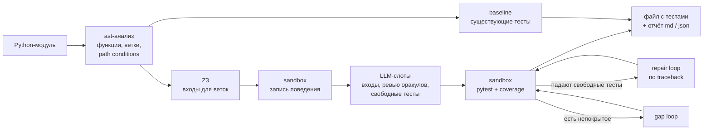
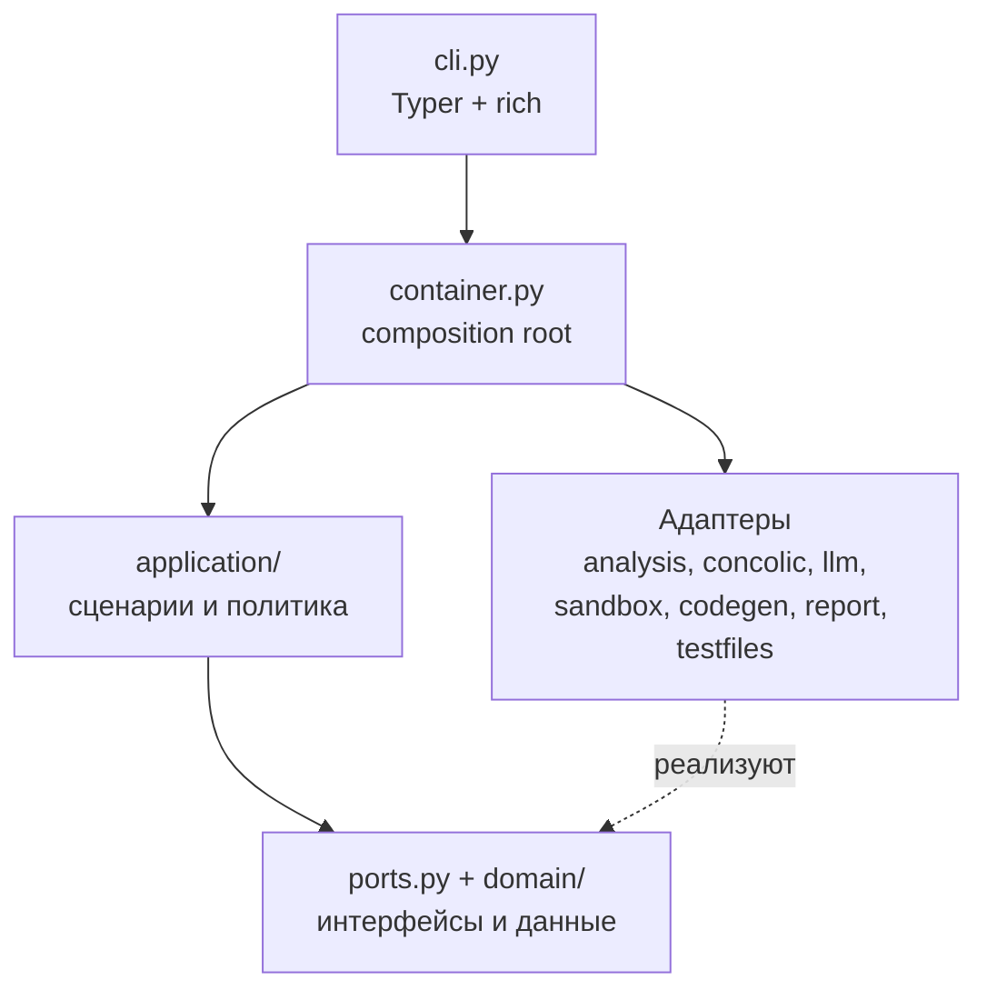
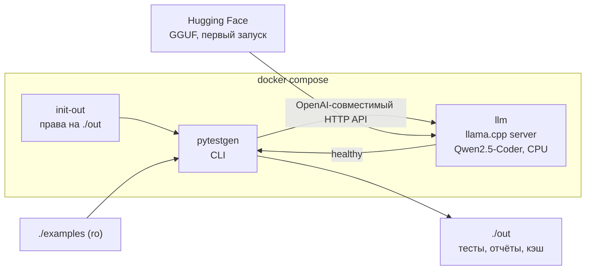

# pytestgen

LLM-assisted генератор pytest-тестов для Python-модулей. Гибридный подход: статический анализ
(`ast`), concolic-lite поиск входов для каждой ветки (AST path conditions + Z3), запись
фактического поведения в изолированном подпроцессе и маленькая локальная LLM (Qwen2.5-Coder
1.5B/3B на CPU) для того, что символьный анализ не берёт: входы для нерешённых веток, ревью
ожидаемых значений по docstring и свободные тесты для методов классов. Падающие тесты чинятся по
traceback, а результат оформляется отчётом о приросте покрытия.

- [Что делает](#что-делает)
- [Быстрый старт](#быстрый-старт)
- [Демо одной командой (Docker Compose)](#демо-одной-командой-docker-compose)
- [CLI](#cli)
- [Архитектура](#архитектура)
- [Ключевые решения](#ключевые-решения)
- [Тестирование и качество](#тестирование-и-качество)
- [GitHub Action для pull request](#github-action-для-pull-request)
- [Известные ограничения](#известные-ограничения)
- [Структура проекта](#структура-проекта)

## Что делает

Постановка задачи: CLI, который по Python-модулю

1. разбирает модуль (`ast`, плюс `inspect` в изолированном процессе для проверки импорта и
   сигнатур): функции, методы, аннотации, docstring, ветвления;
2. строит тесты pytest: входы для каждой ветки ищет Z3, ожидаемые значения записывает из реального
   выполнения, LLM заполняет слоты и пишет свободные тесты;
3. запускает сгенерированные тесты в изолированном подпроцессе pytest с таймаутом и измерением
   покрытия;
4. чинит падающие тесты по traceback (repair loop), а то, что починить не удалось, выносит в отчёт;
5. выдаёт отчёт о приросте покрытия (строки и ветки, по функциям и по источникам тестов) в консоль,
   markdown и JSON и записывает файл с тестами;
6. умеет работать как GitHub Action: на pull request генерирует тесты для изменённых файлов и
   оставляет один комментарий с отчётом (см. [ниже](#github-action-для-pull-request)).

LLM подключается только по OpenAI-совместимому HTTP API (llama.cpp server, Ollama, vLLM, облачные
провайдеры). Адрес и модель берутся из переменных окружения и в коде не зашиты. Реальная модель
используется только в тестах с маркером `slow`; обычный CI всегда работает с моком.

Пример на демо-проекте [`examples/`](examples/README.md): модуль `shop/pricing.py` с тремя
существующими тестами покрыт на 37.5% строк. Только Z3 и граничные значения, без модели, поднимают
покрытие строк до 95.8%, ветвей - с 26.5% до 94.1% (замер на этом репозитории). Остаток и ревью
оракулов добавляет LLM. В `free_shipping` специально спрятан баг (`> 100` вместо `>= 100`
из docstring), который должен подсветить оракул-ревью.

## Быстрый старт

Нужны Python >= 3.11 и [uv](https://docs.astral.sh/uv/).

```bash
uv sync                          # окружение + dev-зависимости
uv run pytestgen --help
```

Статический анализ и решатель работают без модели и сети:

```bash
uv run pytestgen analyze examples/shop/pricing.py --project-root examples
```

Генерация тестов нуждается в OpenAI-совместимом endpoint. Если его нет, пайплайн всё равно
отработает на Z3 и граничных значениях (с предупреждениями в логе), но методы классов останутся без
тестов. Варианты endpoint:

```bash
# 1) llama.cpp + Qwen2.5-Coder из этого репозитория (нужен Docker, ~1.1 GB загрузки)
docker compose up -d --wait llm            # или: make llm
export PYTESTGEN_LLM_BASE_URL=http://localhost:8080/v1
export PYTESTGEN_LLM_MODEL=qwen2.5-coder-1.5b-instruct

# 2) Ollama
export PYTESTGEN_LLM_BASE_URL=http://localhost:11434/v1
export PYTESTGEN_LLM_MODEL=qwen2.5-coder:1.5b

# 3) облачный провайдер
export PYTESTGEN_LLM_BASE_URL=https://openrouter.ai/api/v1
export PYTESTGEN_LLM_MODEL=<model-id>
export PYTESTGEN_LLM_API_KEY=<key>
export PYTESTGEN_LLM_JSON_MODE=json_object   # если провайдер не принимает json_schema
```

Затем:

```bash
uv run pytestgen generate examples/shop/pricing.py --project-root examples \
    --output out/test_pricing_generated.py --report-md out/report.md --report-json out/report.json
```

Файл `.env` в текущей директории читается автоматически (шаблон: [`.env.example`](.env.example)).
Результат можно запустить отдельно:

```bash
PYTHONPATH=examples uv run pytest out/test_pricing_generated.py
```

### Переменные окружения

Все настройки лежат в `src/pytestgen/config.py`; команда `pytestgen config` печатает действующие
значения (ключ API маскируется).

| Переменная | По умолчанию | Назначение |
| --- | --- | --- |
| `PYTESTGEN_LLM_BASE_URL` | `http://localhost:8080/v1` | Базовый URL OpenAI-совместимого API. |
| `PYTESTGEN_LLM_MODEL` | `qwen2.5-coder-1.5b-instruct` | Имя модели в запросе. |
| `PYTESTGEN_LLM_API_KEY` | не задан | Bearer-токен (для локального сервера не нужен). |
| `PYTESTGEN_LLM_JSON_MODE` | `json_schema` | `json_schema`, `json_object` или `none`: как просить структурированный ответ. При отказе сервера режим автоматически понижается. |
| `PYTESTGEN_LLM_TIMEOUT_S` | `180` | Таймаут одного HTTP-запроса. |
| `PYTESTGEN_LLM_MAX_RETRIES` | `3` | Повторы при 429, 5xx и сетевых ошибках. |
| `PYTESTGEN_LLM_TEMPERATURE` | `0.2` | Зарезервирована: сейчас не используется, у каждого промпта своя температура (0.0-0.3). |
| `PYTESTGEN_LLM_MAX_TOKENS` | `1024` | Зарезервирована: сейчас не используется, у каждого промпта свой лимит. |
| `PYTESTGEN_LLM_SEED` | `42` | Зарезервирована: сейчас запросы всегда идут с `seed=42`. |
| `PYTESTGEN_CACHE_ENABLED` | `true` | Дисковый кэш ответов LLM. |
| `PYTESTGEN_CACHE_DIR` | `.pytestgen/cache` | Каталог кэша (в образе Docker: `/home/app/.pytestgen/cache`, каталог доступен пользователю `app`). |
| `PYTESTGEN_RUN_TIMEOUT_S` | `120` | Предел одного прогона pytest в sandbox. |
| `PYTESTGEN_TEST_TIMEOUT_S` | `10` | Предел одного теста. |
| `PYTESTGEN_RECORD_TIMEOUT_S` | `10` | Предел записи поведения функции. |
| `PYTESTGEN_REPAIR_ATTEMPTS` | `2` | Попыток исправить упавший свободный тест. |
| `PYTESTGEN_GAP_ITERATIONS` | `2` | Раундов "добить непокрытый код". |
| `PYTESTGEN_MAX_CASES_PER_FUNCTION` | `12` | Предел кейсов на функцию. |
| `PYTESTGEN_MAX_MINIMIZE_RUNS` | `12` | Бюджет пробных прогонов для `--minimize`. |
| `PYTESTGEN_Z3_TIMEOUT_MS` | `2000` | Бюджет Z3 на одну ветку. |
| `PYTESTGEN_LOG_LEVEL` | `INFO` | `DEBUG`, `INFO`, `WARNING`, `ERROR`, `CRITICAL`. |
| `PYTESTGEN_LOG_FORMAT` | `json` | `json` (stderr, по строке на событие) или `console`. |

## Демо одной командой (Docker Compose)

Требования: Docker с Compose v2, около 8 GB свободной RAM (контейнер модели ограничен `6g`;
вся система укладывается в предел 24 GB), GPU не нужен, интернет нужен для первого запуска
(скачивание образов и модели).

```bash
docker compose run --rm --build pytestgen
```

Что произойдёт:

1. соберётся образ `pytestgen:local` (multi-stage, непривилегированный пользователь);
2. поднимется сервис `llm` - llama.cpp server на CPU с Qwen2.5-Coder-1.5B-Instruct (Q4_K_M).
   При первом запуске модель (~1.1 GB) скачивается в named volume `llm-models`, затем
   запуски берут файл из этого кэша. Healthcheck допускает до 15 минут на загрузку;
3. сервис `pytestgen` дожидается готовности модели и запускает генерацию тестов для
   `examples/shop/pricing.py` (проект монтируется только на чтение).

Результаты появятся в `./out/`:

| Файл | Содержимое |
| --- | --- |
| `out/test_pricing_generated.py` | Сгенерированные тесты. |
| `out/report.md` | Отчёт: прирост покрытия, вклад источников, отброшенные тесты, подозрительные места. |
| `out/report.json` | Тот же отчёт в JSON. |
| `out/.cache/` | Кэш ответов модели: повторный запуск не вызывает LLM. |

Остановить сервер модели: `docker compose down` (с флагом `-v` удалится и скачанная модель).

Полезно знать:

- Тесты импортируют `shop.pricing`, поэтому отдельно они запускаются так:
  `PYTHONPATH=examples pytest out/test_pricing_generated.py`.
- Повторный запуск отдаётся из кэша. Чтобы заставить модель отвечать заново, замените команду:
  `docker compose run --rm pytestgen generate project/shop/pricing.py --project-root project
  --output out/test_pricing_generated.py --report-md out/report.md --report-json out/report.json
  --no-cache`.
- Модель 3B (лучше качество, ~2.1 GB, лимит памяти 8 GB):
  `docker compose --env-file scripts/llm-3b.env run --rm --build pytestgen`.
- Все параметры compose (`LLM_HF_REPO`, `LLM_HF_QUANT`, `LLM_MODEL_NAME`, `LLM_CTX_SIZE`,
  `LLM_THREADS`, `LLM_MEM_LIMIT`, `LLM_HOST_PORT`, `PYTESTGEN_IMAGE`) переопределяются через `.env`.
- Алиасы `make demo`, `make demo-3b`, `make llm`, `make down`, `make clean-models` - тонкие обёртки
  над командами выше.
- Образ llama.cpp зафиксирован тегом `server-b11459`. Время генерации на CPU зависит от машины;
  на реальной модели в этой документации оно не замерялось.

Сценарий живой демонстрации на 10 минут: [docs/demo.md](docs/demo.md).

## CLI

Глобальные опции указываются перед командой: `pytestgen --log-level DEBUG --log-format console generate ...`.

| Команда | Назначение |
| --- | --- |
| `pytestgen analyze TARGET` | Функции, цели по веткам, path conditions и (с `--solve`) входы от Z3. Без LLM и sandbox. |
| `pytestgen generate TARGET` | Генерация теста для модуля и отчёт о приросте покрытия. |
| `pytestgen config` | Печать действующей конфигурации (JSON, ключ API маскируется). |
| `pytestgen version` | Версия. |

Глобальные опции: `--log-level` (переопределяет `PYTESTGEN_LOG_LEVEL`), `--log-format json|console`.

### `pytestgen analyze TARGET`

| Опция | Описание |
| --- | --- |
| `--project-root DIR` | Корень проекта (по умолчанию ближайший родитель с `pyproject.toml`, `setup.cfg`, `pytest.ini` или `.git`). |
| `-f`, `--function NAME` | Функция, `Class.method` или имя класса; можно повторять. |
| `--solve` / `--no-solve` | Просить Z3 входы для каждой ветки (по умолчанию включено). |
| `--json` | JSON вместо таблиц. |

### `pytestgen generate TARGET`

| Опция | Описание |
| --- | --- |
| `--project-root DIR` | Корень проекта, как выше. |
| `-o`, `--output PATH` | Файл с тестами (по умолчанию `tests/test_<module>_pytestgen.py` в корне проекта). |
| `-f`, `--function NAME` | Ограничить функциями или классами; повторяемая. |
| `--strategy hybrid\|llm` | `hybrid`: AST + Z3 + LLM-слоты (по умолчанию); `llm`: тесты пишет только модель (для сравнения). |
| `--minimize` | Убрать тесты, не добавляющие покрытия. |
| `--no-cache` | Не читать и не писать кэш ответов LLM. |
| `--existing-tests FILE` | Существующий файл тестов для baseline; повторяемая. |
| `--no-existing-tests` | Baseline без существующих тестов (несовместима с `--existing-tests`). |
| `--dry-run` | Выполнить всё, но не записывать файл с тестами. |
| `--overwrite` | Перезаписать существующий файл, созданный не pytestgen. |
| `--report-md PATH` | Записать markdown-отчёт. |
| `--report-json PATH` | Записать JSON-отчёт. |
| `--fail-under-gain PP` | Код выхода 1, если прирост покрытия строк (в процентных пунктах) ниже порога. |

Коды выхода: `0` - успех, `1` - прирост ниже `--fail-under-gain`, `2` - ошибка использования или
конфигурации, либо невозможность получить проверенный результат (например, модуль не
импортируется или прогон не уложился в таймаут).

## Архитектура

Пайплайн `generate` (подробно: [docs/architecture.md](docs/architecture.md)):



Слои (ports & adapters, зависимости направлены внутрь):



Окружение демо:



## Ключевые решения

Подробности - в [docs/adr](docs/adr/README.md).

| Решение | Зачем | ADR |
| --- | --- | --- |
| Ports & adapters | Изолировать LLM, sandbox и Z3; тестировать пайплайн на fakes без сети | [0001](docs/adr/0001-ports-and-adapters.md) |
| Генерация по одной функции | Короткие промпты для малой модели, изоляция сбоев | [0002](docs/adr/0002-per-function-generation.md) |
| Concolic-lite: AST + Z3, LLM как запасной решатель | Точные входы для арифметики и строк без LLM и без инструментации интерпретатора | [0003](docs/adr/0003-concolic-lite.md) |
| Subprocess sandbox: таймауты, чистое окружение, rlimits | Защита от зависаний и утечки секретов (не граница безопасности) | [0004](docs/adr/0004-subprocess-sandbox.md) |
| Результаты через `junit.xml` и coverage JSON | Изоляция процесса и стабильные форматы вместо `pytest.main()` | [0005](docs/adr/0005-junit-and-coverage-json.md) |
| Свой клиент на httpx + tenacity, моки через respx | Работа с любым OpenAI-совместимым API, понижение `response_format`, circuit breaker | [0006](docs/adr/0006-own-http-client.md) |
| Неисправимые тесты - в отчёт, не в файл | Файл всегда зелёный, потери видны | [0007](docs/adr/0007-unfixable-tests-to-report.md) |
| `--minimize` опционален | Не платить прогонами за компактность по умолчанию | [0008](docs/adr/0008-optional-minimize.md) |
| Дисковый кэш ответов, temperature 0.2, seed | Воспроизводимость, быстрые повторные прогоны и демо | [0009](docs/adr/0009-disk-llm-cache.md) |
| structlog JSON в stderr, rich в stdout | Машинные события и читаемый вывод не смешиваются | [0010](docs/adr/0010-logging-and-cli-output.md) |
| uv, Python 3.12 в Docker и CI, >= 3.11 | Воспроизводимые окружения | [0011](docs/adr/0011-uv-and-python-versions.md) |
| Гибрид "шаблон + LLM-слоты", `--strategy llm` для сравнения | Малая модель надёжна в коротких задачах с JSON-схемой, не в целых тестах | [0012](docs/adr/0012-hybrid-template-plus-llm-slots.md) |

Выбор модели: Qwen2.5-Coder-1.5B-Instruct (по умолчанию) и 3B в квантизации Q4_K_M, GGUF через
llama.cpp на CPU. Это укладывается в предел 24 GB RAM без GPU (~6 GB для 1.5B, ~8 GB для 3B с
контекстом 8192), а сервер даёт OpenAI-совместимый API, так что замена модели - вопрос переменных
окружения.

## Тестирование и качество

```bash
uv run pytest -m "not slow" --cov=pytestgen --cov-branch   # быстрые тесты, LLM замокан
uv run ruff check . && uv run ruff format --check .
uv run mypy                                                # strict, пакет src/pytestgen
uv run pre-commit install                                  # ruff, ruff-format, mypy, uv lock --check
```

- **Тесты.** 1809 тестов без маркера `slow`: `tests/unit/` (по пакетам, с fakes на границах портов),
  `tests/integration/` (CLI и `generate` end-to-end со скриптованной LLM), записанные ответы в
  `tests/fixtures/llm/`. HTTP-вызовы мокаются через `respx`. Покрытие веток около 99%
  (98.8% на момент написания), порог в `pyproject.toml` - `fail_under = 70`.
- **Маркер `slow`.** `tests/slow/test_real_llm.py` вызывает настоящую модель; такие тесты
  пропускаются без `PYTESTGEN_LLM_BASE_URL`, а с `PYTESTGEN_SLOW_REQUIRE_LLM=1` падают при
  недоступном сервере. Локально: `docker compose up -d --wait llm`, затем
  `PYTESTGEN_LLM_BASE_URL=http://localhost:8080/v1 uv run pytest -m slow -v` (или `make slow`).
  Маркеры строгие (`--strict-markers`).
- **Линтеры.** `ruff` (наборы E, W, F, I, B, UP, SIM, C4, PTH, RUF, T20, S, N, PL), `mypy --strict`,
  `pre-commit`; хуки вызывают инструменты через `uv run`, версии берутся из `uv.lock`.
- **CI (GitHub Actions).**
  - `ci.yml`: lint и типы; тесты на Python 3.11 и 3.12 с покрытием (сводка в Job Summary,
    артефакты `coverage.xml` и `junit.xml`); сборка Docker-образа и smoke-тест; публикация в
    Docker Hub включается при наличии секретов. LLM в нём всегда мокается.
  - `slow.yml`: маркер `slow` и демо CLI на реальной модели (llama.cpp в контейнере), вручную,
    по ночам и при push в ветки `slow/**`.
  - `pr-tests.yml`: GitHub Action на pull request (см. ниже).

## GitHub Action для pull request

Composite action ([`action.yml`](action.yml)) на каждый pull request выбирает изменённые Python-файлы
(`git diff base...HEAD`, без тестов и `__init__.py`), генерирует для каждого тесты, публикует один
sticky-комментарий с отчётом (маркер `<!-- pytestgen-report -->`, повторный запуск обновляет
комментарий) и загружает сгенерированные тесты артефактом. В ветку PR ничего не коммитится.

```yaml
name: pytestgen
on:
  pull_request:
permissions:
  contents: read
  pull-requests: write
jobs:
  generate:
    runs-on: ubuntu-latest
    steps:
      - uses: actions/checkout@v4
        with:
          fetch-depth: 0              # нужна история для diff с базой PR
          persist-credentials: false
      - uses: ark2016/mipt-9-pytestGen@<tag-or-sha>
        with:
          llm-base-url: ${{ vars.PYTESTGEN_LLM_BASE_URL }}
          llm-model: ${{ vars.PYTESTGEN_LLM_MODEL }}
          llm-api-key: ${{ secrets.PYTESTGEN_LLM_API_KEY }}
          paths: src/**/*.py
          max-files: "5"
```

Основные входы: `llm-base-url`, `llm-model`, `llm-api-key`, `llm-json-mode` (по умолчанию
`json_schema`), `paths` (по умолчанию `src/**/*.py`), `max-files` (5), `strategy`
(`hybrid` или `llm`), `python-version` (3.12), `extra-packages` (зависимости тестируемого кода),
`comment` (`true`), `file-timeout` (1200 с), `fail-on-error` (`false`). Выходы: `report-path`
(summary.json) и `comment-body-path`.

Сервер LLM action не запускает: укажите любой OpenAI-совместимый endpoint. В самом репозитории
[`pr-tests.yml`](.github/workflows/pr-tests.yml) использует `uses: ./` и выбирает backend сам:
если заданы секрет `PYTESTGEN_LLM_API_KEY` и переменная `PYTESTGEN_LLM_BASE_URL`, то облако,
иначе на раннере поднимается llama.cpp с Qwen2.5-Coder-0.5B (так работают и PR из форков, у которых
нет секретов; комментарий для них пропускается, отчёт остаётся в Job Summary и в артефакте).
Только Linux-раннеры.

## Известные ограничения

- **Качество малой модели.** Qwen2.5-Coder 1.5B/3B ошибается: часть свободных тестов приходится
  чинить или выбрасывать (они попадают в раздел отброшенных в отчёте). Оценок качества на реальной
  модели в этой документации нет; приведённые цифры прироста получены без модели.
- **Concolic-lite неполон.** Решатель понимает условия над `int`, `float`, `str`, `bool`,
  `Optional` и `len()` списков, кортежей и bytes. Циклы, `try`, повторно присваиваемые переменные,
  вызовы других функций, атрибуты объектов и коллекции по значению не моделируются: такая
  ветка уходит модели (она может не справиться).
- **Методы экземпляра только через LLM.** Z3 работает для функций верхнего уровня и
  `staticmethod`; состояние объекта придумывает модель.
- **Не security sandbox.** Подпроцесс с таймаутами, rlimits (только POSIX), чистым окружением и
  статическим guard защищает от зависаний и случайных последствий, но не от злонамеренного кода:
  сети и файловой системы он не изолирует. Недоверенный код запускайте в контейнере.
- **Окружение тестируемого кода.** Sandbox использует интерпретатор самого pytestgen, поэтому
  зависимости проекта должны быть установлены в нём (в Docker-образе только стандартная библиотека;
  в Action для этого есть `extra-packages`).
- **Тесты фиксируют поведение, а не спецификацию.** Ожидаемые значения записываются из выполнения.
  Баг, не замеченный оракулом, окажется "закреплённым" в тесте (пример: граничный кейс
  `free_shipping(100.0) == False` без LLM-ревью). Ревью опирается на docstring (нет docstring - нет
  ревью), а малая модель даёт и ложные `suspected bug`. Тест, переписанный под поведение кода, тоже
  помечается как возможный баг.
- **Недетерминированный код отбрасывается.** Функции, результат которых меняется между двумя
  запусками (время, `random`, адреса объектов), и значения без литерального вида в таблицы не
  попадают.
- **Windows.** pytest-timeout там работает методом `thread` и убивает весь процесс pytest: упавший по
  таймауту тест исключается, остальные перезапускаются (до 3 раз), покрытие может быть неполным.
  `RLIMIT_*` недоступны.
- **Z3 и длинные строки.** Строки предпочитаются короче 32 символов, потолок 256, бюджет 2 с на
  ветку; условия, требующие длинных строк, решаются медленно или не решаются.
- **Незадействованные настройки.** `PYTESTGEN_LLM_TEMPERATURE`, `_MAX_TOKENS` и `_SEED` пока не влияют
  на запросы (см. таблицу переменных).
- **Один модуль за запуск.** Нет тестов на взаимодействие модулей и на состояние между вызовами.
- **Демо.** Первый запуск скачивает ~1.1 GB; скорость генерации на CPU не замерялась. Compose и
  workflow'ы проверены статически (`docker compose config`, `actionlint`), на реальном контейнере не
  запускались.

## Структура проекта

```text
.
├── src/pytestgen/
│   ├── cli.py, cli_views.py      # Typer-команды, rich-вывод
│   ├── container.py              # composition root
│   ├── config.py                 # Settings: все PYTESTGEN_*
│   ├── ports.py                  # интерфейсы (Protocol)
│   ├── domain/                   # модель данных без I/O
│   ├── application/              # сценарии, промпты, guard, repair, gap loop, бюджеты
│   ├── analysis/                 # ast-анализ, цели по веткам
│   ├── concolic/                 # Z3: перевод условий и поиск входов
│   ├── sandbox/                  # подпроцессы: introspect, record, pytest + coverage
│   ├── llm/                      # HTTP-клиент, дисковый кэш
│   ├── codegen/                  # печать тестового модуля
│   ├── report/                   # markdown, JSON, консоль
│   ├── testfiles/                # поиск и запись файлов с тестами
│   └── log.py, errors.py
├── tests/                        # unit, integration, slow, fixtures
├── examples/                     # демо-проект (shop/pricing.py, shop/cart.py, textkit.py)
├── docs/                         # architecture.md, adr/, demo.md
├── scripts/                      # pr_comment.py (для Action), llm-3b.env
├── action.yml                    # composite GitHub Action
├── .github/workflows/            # ci.yml, slow.yml, pr-tests.yml
├── Dockerfile, docker-compose.yml, Makefile
└── pyproject.toml, uv.lock
```
