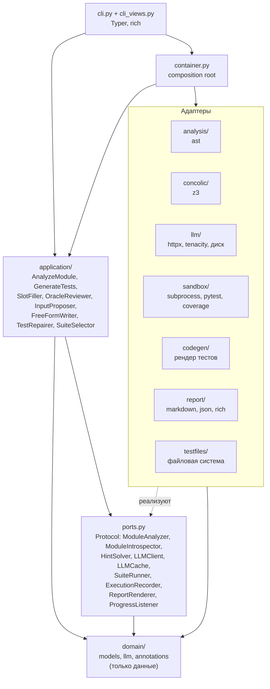
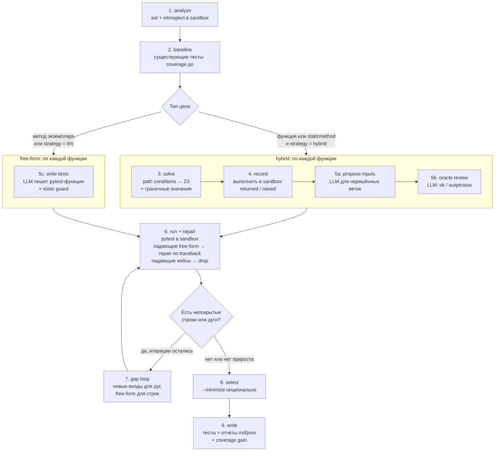
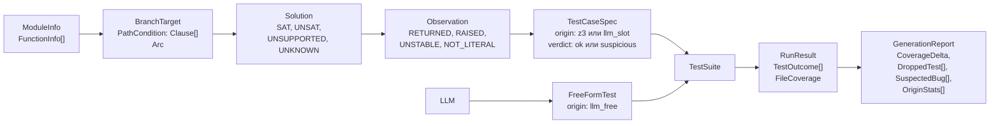

# Архитектура pytestgen

Документ описывает устройство `src/pytestgen`: слои, пайплайн команды `generate`, модель данных,
обработку ошибок и точки расширения. Решения и их обоснование вынесены в [ADR](adr/README.md).

## 1. Слои и зависимости

Зависимости направлены внутрь: адаптеры знают о портах и домене, приложение знает только о портах
и домене, домен не знает ни о ком. Конкретные адаптеры подставляет composition root
(`container.py`).

Исключения из чистой схемы, о которых полезно знать:

- `application/` использует `codegen` (чистые функции рендера и разбора исходников, без I/O),
  поэтому `codegen` фактически часть ядра, а не внешний адаптер.
- Парсеры ответов модели (`application/extract.py`) относятся к политике приложения и
  реэкспортируются из `llm/extract.py` только для удобства.
- Тест `tests/unit/application/test_app_layering.py` проверяет, что `import pytestgen.application`
  не загружает `httpx`, `tenacity`, `z3` и пакеты адаптеров.

## 2. Пакеты

| Пакет / модуль | Ответственность |
| --- | --- |
| `config.py` | `Settings` (pydantic-settings, префикс `PYTESTGEN_`, файл `.env`); `JsonMode`, `LogFormat`. |
| `domain/models.py` | Модель данных: `ModuleInfo`, `FunctionInfo`, `BranchTarget`, `PathCondition`, `Solution`, `Observation`, `TestCaseSpec`, `FreeFormTest`, `TestSuite`, `RunResult`, `FileCoverage`, `GenerationReport` и др. |
| `domain/llm.py` | `ChatMessage`, `ChatRequest` (temperature 0.2, seed 42 по умолчанию), `ChatResponse`, `ResponseSchema`. |
| `analysis/` | Статический разбор модуля через `ast` без импорта: функции, сигнатуры, docstring, цели по веткам с path conditions и дугами coverage. |
| `concolic/` | `Z3HintSolver`: перевод условий в Z3, поиск "красивой" модели, проверка в семантике Python. |
| `sandbox/` | `SubprocessIntrospector`, `SubprocessExecutionRecorder`, `SubprocessSuiteRunner`; копия проекта, чистое окружение, таймауты, разбор junit и coverage JSON. |
| `llm/` | `OpenAICompatClient` (HTTP, retries, понижение `response_format`), `DiskLLMCache`, `CachingLLMClient`. |
| `codegen/` | Печать модуля pytest: таблицы `parametrize`, литералы, импорты, разбор тестов модели на части. |
| `application/` | Сценарии и политика: `AnalyzeModule`, `GenerateTests`, `SkeletonBuilder`, `SlotFiller`, `OracleReviewer`, `InputProposer`, `FreeFormWriter`, `TestRepairer`, `SuiteSelector`, guard, промпты, бюджеты, `CircuitBreakerLLMClient`. |
| `report/` | `MarkdownRenderer`, `JsonRenderer` (и чтение JSON), консольный вид (rich). |
| `testfiles/` | `LocalTestFiles`: поиск существующих тестов, запись выходного файла, определение файлов, созданных pytestgen. |
| `log.py`, `errors.py` | structlog в stderr; иерархия `PytestgenError`. |
| `cli.py`, `cli_views.py` | Команды `analyze`, `generate`, `config`, `version`; прогресс и таблицы. |

## 3. Пайплайн `generate`

Сценарий реализован в `application/generate.py` (`GenerateTests`, внутри - класс `_Run`).

Стадии, которые видит пользователь (`ports.Stage`): `analyze`, `baseline`, `solve`, `record`,
`llm_slots`, `run`, `repair`, `gap`, `select`, `write`.

Подробности по шагам:

1. **analyze.** `AstModuleAnalyzer` строит `ModuleInfo`, не исполняя код. `SubprocessIntrospector`
   импортирует модуль в sandbox: если импорт не удался, команда завершается с понятной
   ошибкой (`ModuleImportError`) ещё до обращения к модели.
2. **baseline.** `LocalTestFiles.discover` находит в проекте файлы `test_*.py` и `*_test.py`, где
   упоминается имя модуля (файлы pytestgen пропускаются по заголовку). Их прогон даёт покрытие
   "до". Если существующие тесты не собираются или зависают, они игнорируются с предупреждением.
   Флаги `--existing-tests` и `--no-existing-tests` меняют это поведение.
3. **solve.** Для каждой цели (ветка, сторона T/F) `Z3HintSolver` пытается найти вход
   ([ADR 0003](adr/0003-concolic-lite.md)). Результат: `SAT` с входом, `UNSAT` (ветка
   недостижима, цель помечается как infeasible), `UNSUPPORTED` или `UNKNOWN`.
   Для сравнений вида `param <op> константа` добавляются граничные векторы.
4. **record.** `SubprocessExecutionRecorder` выполняет функцию на каждом входе дважды;
   расхождение даёт `UNSTABLE` (недетерминированный код отбрасывается). Итог: вернулось
   значение (`RETURNED`, хранится как литерал), поднято исключение (`RAISED`), либо значение без
   литерального представления (`NOT_LITERAL`, отбрасывается).
5. **LLM-слоты.** Входы для нерешённых целей (`InputProposer`), оракул-ревью записанного поведения
   по docstring (`OracleReviewer`, вердикт `suspicious` исключает кейс из файла и добавляет запись
   `SuspectedBug`), либо свободные тесты (`FreeFormWriter`, проходят `check_test_source`).
6. **run + repair** (`_Run._stabilize`). Набор рендерится в тестовый файл и запускается в sandbox
   ([ADR 0005](adr/0005-junit-and-coverage-json.md)). Упавшие кейсы таблиц снимаются
   (`unstable`), упавшие свободные тесты уходят в `TestRepairer` (до 2 попыток по умолчанию),
   затем набор запускается снова, пока всё не позеленеет.
7. **gap loop** (`_Run._fill_gaps`). По непокрытым дугам модель просит новые входы, по непокрытым
   строкам - свободные тесты. Итерация без прироста `coverage_score` (строки + дуги) откатывается
   (`checkpoint` / `rollback`) и цикл останавливается.
8. **select.** Без `--minimize` остаётся всё зелёное; с ним жадно удаляются тесты без прироста
   ([ADR 0008](adr/0008-optional-minimize.md)).
9. **write.** Файл записывается через порт `ProjectTestFiles`; по умолчанию
   `<project_root>/tests/test_<module>_pytestgen.py`. Файл, созданный не pytestgen, без `--overwrite`
   не перезаписывается. Формируется `GenerationReport`: дельта покрытия (общая и по функциям),
   вклад по источникам (`z3`, `llm_slot`, `llm_free`), отброшенные тесты, подозрительные места,
   расход LLM, длительность.

Стратегия `--strategy llm` заменяет шаги 3-5 одним: свободные тесты для каждой функции.

## 4. Модель данных

Типы домена - неизменяемые dataclass-ы (`frozen=True, slots=True`); изменяемое состояние одного прогона - только
`application/state.py` (`RunState`), с поддержкой `checkpoint` / `rollback` для gap-цикла.

## 5. Взаимодействие с моделью

- Все промпты собраны в `application/prompts.py`: короткие, с минимальным форматом ответа.
  JSON-ответы описаны схемами (`ORACLE_REVIEW_SCHEMA`, `PROPOSE_INPUTS_SCHEMA`) и передаются
  как `response_format: json_schema`; при отказе сервера режим понижается до `json_object`, затем
  до свободного текста, разбираемого лениво (`application/extract.py`).
- Цепочка клиента: `CachingLLMClient(CircuitBreakerLLMClient(OpenAICompatClient))`.
  Кэш проверяется первым, circuit breaker прекращает вызовы после первой ошибки соединения.
- Адрес и имя модели берутся только из `PYTESTGEN_LLM_BASE_URL` и `PYTESTGEN_LLM_MODEL`,
  в коде они не зашиты (значения по умолчанию в `config.py` нужны для запуска без `.env`).
- Ответ, который не удалось разобрать, не прерывает пайплайн: логируется предупреждение, функция
  остаётся с тем, что дал Z3.

## 6. Ошибки и деградация

| Ситуация | Поведение |
| --- | --- |
| Модуль не импортируется | Ошибка до вызовов LLM, код выхода 2. |
| Модель недоступна | Первая ошибка соединения размыкает circuit breaker; остаются тесты из Z3 и граничных значений. |
| Ответ модели непригоден (не JSON, не Python, не прошёл guard) | Предупреждение в логе; free-form тест попадает в `dropped` с причиной `invalid_code`. |
| Ошибка sandbox на одной функции | `function_skipped`, остальные функции обрабатываются. |
| Таймаут прогона (`PYTESTGEN_RUN_TIMEOUT_S`) | Результат не проверен, файл не пишется, ошибка с подсказкой, код выхода 2. |
| Существующие тесты не собираются | Игнорируются, baseline считается без них. |
| `--fail-under-gain` и прирост строк ниже порога | Код выхода 1 (файл и отчёты уже записаны). |

Коды выхода: 0 - успех, 1 - прирост покрытия ниже `--fail-under-gain`, 2 - ошибка использования или
конфигурации либо невозможность получить проверенный результат.

## 7. Точки расширения

- **Другой LLM-бэкенд:** достаточно сменить `PYTESTGEN_LLM_BASE_URL` / `PYTESTGEN_LLM_MODEL`; для
  нестандартного протокола реализовать `LLMClient` и подставить в `container.py`.
- **Другой решатель:** реализация `HintSolver` (например, на другом SMT-движке).
- **Другой формат отчёта:** реализация `ReportRenderer` (уже есть markdown и JSON).
- **Другой раннер тестов:** реализация `SuiteRunner` (например, запуск в Docker-контейнере).
  Это также путь к настоящей изоляции ([ADR 0004](adr/0004-subprocess-sandbox.md)).

## 8. Развёртывание

- `Dockerfile` - образ с CLI (`ENTRYPOINT ["pytestgen"]`), пользователь uid 1000.
- `docker-compose.yml` - три сервиса: `init-out` (права на `./out`), `llm` (llama.cpp server с
  Qwen2.5-Coder, CPU) и `pytestgen` (демо-команда). Подробности запуска - в [README](../README.md).
- `action.yml` + `scripts/pr_comment.py` - composite GitHub Action: выбор изменённых файлов PR,
  генерация, один sticky-комментарий с отчётом, артефакт со сгенерированными тестами.
- Workflow-файлы: `ci.yml` (lint, mypy, тесты с моком LLM, сборка образа), `slow.yml` (реальная
  модель в CI, ночью и по запросу), `pr-tests.yml` (action на pull request).
